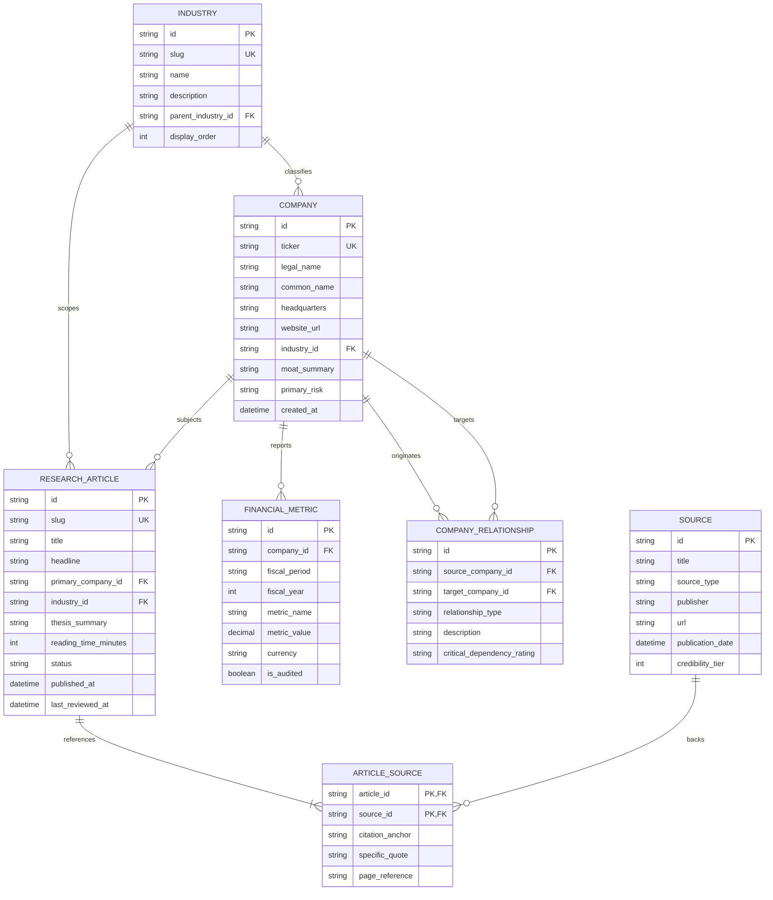

# Database Design & Entity Architecture: AbdusSameer Technology Research Platform

**Document Version:** 1.1.0  
**Status:** Approved Future Data Model Specification  
**Classification:** Data Modeling, Schema Definitions & Relational Architecture  

---

## 1. Context & Architectural Status

> [!IMPORTANT]
> **Database Implementation is a DEFERRED DECISION (Phase 3).**
> The initial production website (MVP / Phase 1) is entirely file-based, utilizing version-controlled Markdown/MDX documents and static JSON data structures inside the repository.
>
> A dedicated relational database (e.g., PostgreSQL / Supabase) is **not required** for the initial portfolio and editorial publication. This document defines the canonical domain model, entities, and relational structures required when the platform transitions to **Phase 3 (Technology Research Intelligence Platform)**.
>
> **Canonical Rule (ADR-005):** When a database is introduced, it **must never store competing copies of MDX article bodies**. Git remains the sole and final source of truth for editorial research text. The database stores strictly structured metadata, financial metrics, and economic relationships.

---

## 2. Domain Entities Overview

The data architecture is structured around six core domain entities:

```
┌─────────────────┐             ┌─────────────────────┐
│    Industry     │◄────────────┤       Company       │
│  (Sector/Stack) │             │ (ASML, NVDA, etc.)  │
└────────┬────────┘             └──────────┬──────────┘
         │                                 │
         │                                 ├──────────────────────────────┐
         ▼                                 ▼                              ▼
┌─────────────────┐             ┌─────────────────────┐       ┌──────────────────────┐
│ ResearchArticle │◄────────────┤  FinancialMetric    │       │ CompanyRelationship  │
│ (Metadata Only) │             │  (Historical KPIs)  │       │ (Economic Moat Link) │
└────────┬────────┘             └─────────────────────┘       └──────────────────────┘
         │
         ▼
┌─────────────────┐
│     Source      │
│ (SEC, IEEE, etc)│
└─────────────────┘
```

1. **`Industry` (Sector / Supply Chain Layer):** Categorizes where companies operate across the technology stack (e.g., EUV Lithography, Advanced Packaging, GPU Accelerators, Enterprise SaaS, IT Modernization).
2. **`Company`:** Profiles public and private technology companies subject to research.
3. **`ResearchArticle` (Metadata Only):** Index records of published teardowns (title, slug, reading time, publication dates, and thesis summaries). The full analytical prose lives in Git.
4. **`Source`:** Verified primary and secondary evidence records (SEC 10-K, earnings call transcripts, IEEE research papers).
5. **`FinancialMetric`:** Structured financial and operational metrics (Revenue, Gross Margin, R&D % of Revenue, Free Cash Flow).
6. **`CompanyRelationship` (Economic Value Chain):** Directional linkages mapping technology supply chain choke points, customer concentrations, and competitive rivalries.

### Conceptual Separation from Procurement
`CompanyRelationship` models **macroeconomic dependencies, supplier pricing power, and economic rent distribution** (e.g., Zeiss supplying High-NA EUV optics to ASML, or ASML supplying scanners to TSMC). It **never** represents industrial procurement, parts sourcing, vendor RFQs, or manufacturer directories.

---

## 3. Entity-Relationship Model (Mermaid Diagram)



---

## 4. Entity Schema Specifications (PostgreSQL DDL Reference)

```sql
-- 1. Industries / Technology Sectors
CREATE TABLE industries (
    id UUID PRIMARY KEY DEFAULT gen_random_uuid(),
    slug VARCHAR(64) UNIQUE NOT NULL,
    name VARCHAR(128) NOT NULL,
    description TEXT,
    parent_industry_id UUID REFERENCES industries(id) ON DELETE SET NULL,
    created_at TIMESTAMPTZ DEFAULT NOW()
);

-- 2. Companies
CREATE TABLE companies (
    id UUID PRIMARY KEY DEFAULT gen_random_uuid(),
    ticker VARCHAR(16) UNIQUE,
    legal_name VARCHAR(255) NOT NULL,
    common_name VARCHAR(128) NOT NULL,
    industry_id UUID NOT NULL REFERENCES industries(id),
    headquarters VARCHAR(128),
    business_model_summary TEXT,
    moat_classification VARCHAR(64), -- e.g., 'physical_monopoly', 'ecosystem_lockin'
    created_at TIMESTAMPTZ DEFAULT NOW()
);

-- 3. Research Articles (METADATA ONLY - Article body text lives in Git MDX)
CREATE TABLE research_articles (
    id UUID PRIMARY KEY DEFAULT gen_random_uuid(),
    slug VARCHAR(128) UNIQUE NOT NULL,
    title VARCHAR(255) NOT NULL,
    headline TEXT NOT NULL,
    primary_company_id UUID REFERENCES companies(id) ON DELETE SET NULL,
    industry_id UUID NOT NULL REFERENCES industries(id),
    status VARCHAR(32) DEFAULT 'draft', -- 'draft', 'published', 'archived'
    reading_time_minutes INT NOT NULL DEFAULT 5,
    thesis_summary TEXT NOT NULL,
    in_one_minute_what_it_does TEXT,
    in_one_minute_why_it_matters TEXT,
    in_one_minute_what_to_watch TEXT,
    published_at TIMESTAMPTZ,
    last_reviewed_at TIMESTAMPTZ,
    created_at TIMESTAMPTZ DEFAULT NOW()
);

-- 4. Sources & Primary Evidence
CREATE TABLE sources (
    id UUID PRIMARY KEY DEFAULT gen_random_uuid(),
    title VARCHAR(255) NOT NULL,
    source_type VARCHAR(64) NOT NULL, -- 'sec_10k', 'sec_10q', 'earnings_transcript', 'ieee_paper', 'patent'
    publisher VARCHAR(128) NOT NULL,
    url TEXT NOT NULL,
    publication_date DATE NOT NULL,
    credibility_tier INT NOT NULL CHECK (credibility_tier BETWEEN 1 AND 4)
);

-- 5. Article-Source Junction (Citations)
CREATE TABLE article_sources (
    article_id UUID NOT NULL REFERENCES research_articles(id) ON DELETE CASCADE,
    source_id UUID NOT NULL REFERENCES sources(id) ON DELETE CASCADE,
    citation_anchor VARCHAR(64) NOT NULL, -- e.g., 'cite-1'
    page_reference VARCHAR(32),
    specific_quote TEXT,
    PRIMARY KEY (article_id, source_id, citation_anchor)
);

-- 6. Structured Financial Metrics
CREATE TABLE financial_metrics (
    id UUID PRIMARY KEY DEFAULT gen_random_uuid(),
    company_id UUID NOT NULL REFERENCES companies(id) ON DELETE CASCADE,
    fiscal_period VARCHAR(8) NOT NULL, -- 'FY2025', 'Q3-2025'
    metric_name VARCHAR(64) NOT NULL,  -- 'revenue', 'gross_margin_pct', 'rd_spend_pct', 'capex'
    metric_value NUMERIC(16, 4) NOT NULL,
    currency VARCHAR(3) DEFAULT 'USD',
    is_audited BOOLEAN DEFAULT TRUE,
    created_at TIMESTAMPTZ DEFAULT NOW(),
    CONSTRAINT unique_company_metric_period UNIQUE (company_id, fiscal_period, metric_name)
);

-- 7. Economic Value-Chain & Dependency Relationships
CREATE TABLE company_relationships (
    id UUID PRIMARY KEY DEFAULT gen_random_uuid(),
    source_company_id UUID NOT NULL REFERENCES companies(id),
    target_company_id UUID NOT NULL REFERENCES companies(id),
    relationship_type VARCHAR(64) NOT NULL, -- 'sole_supplier_to', 'major_customer_of', 'technology_partner'
    description TEXT,
    critical_dependency_rating INT CHECK (critical_dependency_rating BETWEEN 1 AND 5),
    created_at TIMESTAMPTZ DEFAULT NOW(),
    CONSTRAINT no_self_relationships CHECK (source_company_id <> target_company_id)
);
```

---

## 5. Transition Path: File-Based MVP to Relational Database

```
┌────────────────────────────────────────┐
│        Phase 1: File-Based MVP         │
│ • Content in /content/analysis/        │
│ • Frontmatter parsed via Zod           │
│ • Zero database overhead               │
└───────────────────┬────────────────────┘
                    │
                    ▼
┌────────────────────────────────────────┐
│     Phase 2: Hybrid In-Memory JSON     │
│ • Static JSON data files               │
│ • Pre-calculated valuation metrics     │
│ • In-browser search index (MiniSearch) │
└───────────────────┬────────────────────┘
                    │
                    ▼
┌────────────────────────────────────────┐
│     Phase 3: Relational Database       │
│ • PostgreSQL via Supabase              │
│ • SQL queries for company graph        │
│ • Metadata only - Article text in Git  │
└────────────────────────────────────────┘
```

---

## 6. Open Questions (Unresolved Decisions)

1. **OPEN QUESTION — Data Provider Ingestion Pipeline (Phase 3):** When structured metrics are populated in Phase 3, should data be curated manually from SEC filings by Abdus Sameer, or ingested via a scheduled SEC EDGAR / financial API scraper?
2. **OPEN QUESTION — Granularity of Financial KPIs:** Should financial tracking be restricted strictly to annual (FY) and quarterly (Q) reports, or should operational milestones (e.g., EUV tool unit shipments, hyperscaler GPU cluster deployments) use an unstructured event log?
